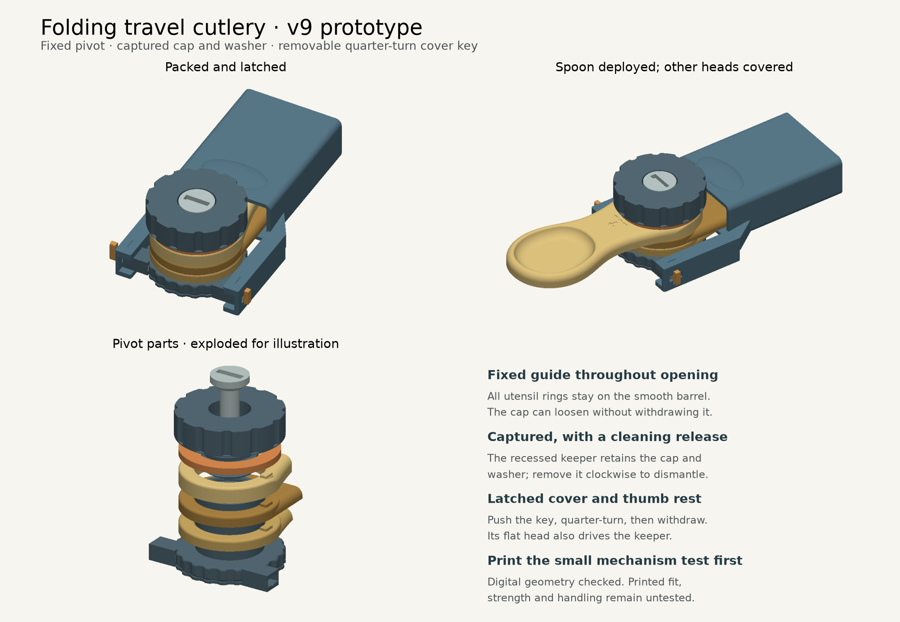

# Folding travel cutlery — v9 prototype

A fully 3D-printed spoon, fork and knife sharing one folding handle. Deploy one utensil at a time; the latched cover shields the unused heads. This repository contains v9 at its designed dimensions.



## Download and print

**Print the smaller mechanism test first** to check the threads, locking tabs and release sequence before printing the full utensils and cover. Its barrel, cap, washer, keeper and cover key can be reused in the full set if their printed fit is satisfactory.

| Download | Contents |
| --- | --- |
| [Complete v9 package](https://github.com/MasteraSnackin/folding-travel-cutlery/releases/download/v9-prototype/cutlery-v9-complete.zip) | Models, individual STLs, instructions, preview, editable source and validation reports |
| [Full set — 3MF](https://github.com/MasteraSnackin/folding-travel-cutlery/releases/download/v9-prototype/cutlery-v9-folding-prototype.3mf) | Nine separate parts arranged for printing |
| [Mechanism test — 3MF](https://github.com/MasteraSnackin/folding-travel-cutlery/releases/download/v9-prototype/cutlery-v9-mechanism-test.3mf) | Three short test rings and five reusable hardware parts |
| [Printing and assembly instructions](instructions.txt) | Print orientation, assembly, opening, dismantling and first physical checks |
| [Individual full-set STLs](print/) / [test STLs](mechanism-test/) | Alternative imports for a slicer |

The 3MF files are **unsliced geometry in millimetres**, with no G-code or applied printer/material profile. Select the actual printer, nozzle and material in the slicer. Print time has not been verified.

The assembled, folded set measures **95.6 × 58.4 × 34 mm**, including the cover and key. The full set's arranged print layout measures approximately **225 × 136.1 × 92.6 mm**. These are different measurements: the first describes the assembled set; the second describes the separate parts on the print plate. The supplied layouts fit within a 256 × 256 mm bed before slicer-added toolpaths and clearance requirements.

## Design changes

- A fixed pivot barrel guides the utensil rings throughout opening.
- A recessed keeper captures the cap and washer, with deliberate removal for dismantling and cleaning.
- Rigid cover arms attach to the base using a removable quarter-turn key and end stops. The key's finger head also operates the keeper.
- Rounded locking-tab roots and lead-ins help alignment.
- A thumb rest, direction arrows and shallow assembly marks aid handling and assembly.
- The repaired fork geometry and reinforced 1.8 mm central spoon floor are retained.

The complete set has nine parts: fork, knife, spoon, washer, barrel, cap, keeper, cover and cover key.

The main cap loosens **anticlockwise**. The central keeper has a left-hand thread and removes **clockwise**, viewed from above. Follow the [full instructions](instructions.txt); remove the cover and separate the keyed interfaces before rotating a utensil.

## Validation status

Digital checks passed for mesh integrity, the tested assembly movements, complete dismantling, print-file contents and reproducibility. A clean rebuild reproduces the 17 STL files byte for byte and the contents of both 3MF packages; ZIP timestamps are excluded from that comparison.

**Printed fit, strength, wear, cover-key retention, comfortable handling and food-contact suitability remain untested.** There is no validated working load, hot-food or dishwasher claim. The cover key has no spring to hold it seated; physical retention needs testing. Digital geometry checks do not establish these properties.

The reports are available in [validation.json](validation.json), [integration-audit.json](integration-audit.json), [package-audit.json](package-audit.json), [rebuild-validation.json](rebuild-validation.json), [pivot-validation.json](pivot-validation.json) and [cover-validation.json](cover-validation.json).

## Rebuild the models

Python 3.12 is the tested version; a compatible newer version may also work. The versions used for this package are pinned in [requirements.txt](requirements.txt).

```sh
python3 -m venv .venv
. .venv/bin/activate
python -m pip install -r requirements.txt
python build_cutlery.py
python audit_v9.py
python verify_package.py --rebuild
python render_preview.py
```

On Windows, activate the environment with `.venv\Scripts\Activate.ps1` in PowerShell.

The build uses the v7 input geometry in [source/](source/). Account metadata was removed from the distributed input; its geometry and build resources are unchanged. [Source provenance](source/provenance.json) records the original and distributed checksums. It does not depend on intermediate review files. `SHA256SUMS.txt` records the distributed files; running a rebuild can change report contents and ZIP timestamps, so use that manifest to check a fresh download before regenerating anything.
